# N5XT (NEXT 5)

**Five mini-games, one platform, one leaderboard.**

N5XT is a small entertainment platform built by *Group N5XT*, a team of first-year students. Players sign in, pick a game from one menu, and have every win and loss recorded on a shared leaderboard.

<p align="center">
  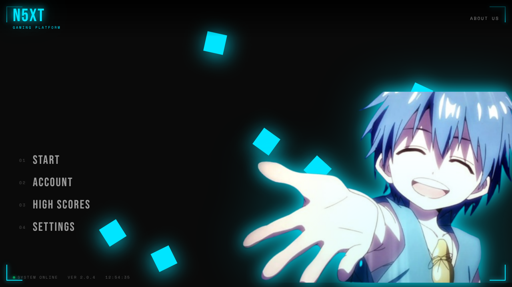
</p>

**Built with:** HTML · CSS · JavaScript (no framework, no build step)

## Contents

- [Features](#features)
- [The games](#the-games)
- [Screens around the games](#screens-around-the-games)
- [How it works](#how-it-works)
- [Project structure](#project-structure)
- [Getting started](#getting-started)
- [Backend endpoints the frontend uses](#backend-endpoints-the-frontend-uses)
- [Known limitations](#known-limitations)
- [About the project](#about-the-project)

---

## Features

- **Five mini-games** in one place: Blackjack, Tic Tac Toe, Ping Pong, Jump Bird and Deflect.
- **Accounts with email verification:** sign up, log in, and reset a forgotten password with a 6-digit code sent by email.
- **Automatic score recording:** every finished round sends a win or a loss, with your username, to the backend.
- **Global leaderboard:** search players, filter by game, sort by wins, win rate, losses or total games.
- **Theme color:** pick an accent color in Settings and the whole interface follows.
- **Cyber-style interface:** neon glow, scanlines, drifting neon squares and screen-wipe transitions between pages.

---

## The games

Open **Start** on the main menu (you need to be logged in) and choose a card.

<p align="center">
  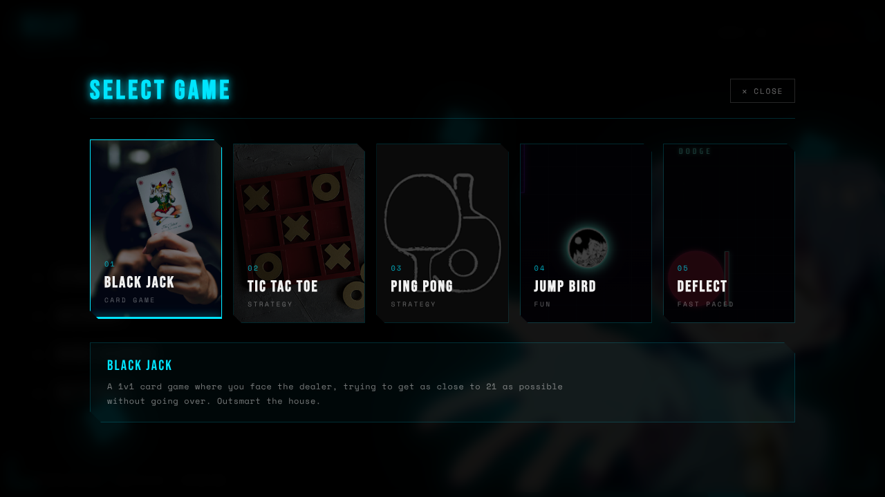
</p>

| # | Game | Folder | Controls | How you win |
|---|---|---|---|---|
| 1 | Blackjack | `Games/Blackjack/` | **Hit** button, **Stand** button | Finish closer to 21 than the dealer without going over |
| 2 | Tic Tac Toe | `Games/TTT/` | Click a cell | Get three in a row before the computer does |
| 3 | Ping Pong | `Games/pingpong/` | `A` / `D` or `←` / `→`, `Space` to start and pause | Be first to 2 points against the CPU |
| 4 | Jump Bird | `Games/test/` | `Space` to flap | Fly through the pillar gaps; every 10 pillars counts as a win |
| 5 | Deflect | `Games/Dodgy/` | `W` `A` `S` `D` to face the shield | Deflect 20 spikes before you lose 3 hearts |

### 1. Blackjack

<p align="center">
  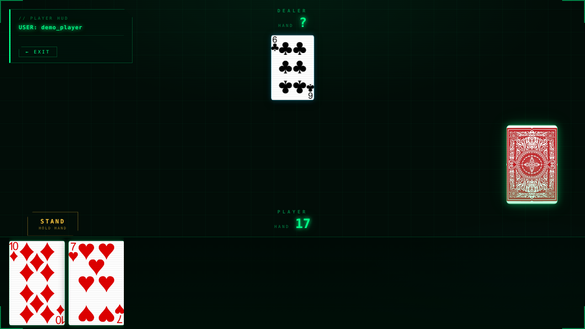
</p>

You play one-on-one against the dealer. **Hit** draws a card; **Stand** locks your hand and reveals the dealer, who keeps drawing until reaching 17 or more.

- The server deals the cards and keeps the running totals. The page asks for the next card number (`/blackjack/number`, `/blackjack/number2`) and reads the totals back (`/blackjack/getTotal`, `/blackjack/getEnemy`).
- The card *suit* is picked in the browser purely for looks, and the image shown is `Cards/<value>_of_<suit>.png`.
- Reaching 21 or going over stands for you automatically. Win, lose or tie is decided in `callStand()` in `Blackjack.js`.
- Wins and losses are submitted when you press **Next Round**. A tie is not recorded.
- `BJD.js` holds the shared state and element references, `Css.js` lifts the intro screen wipe, and `keyframes.css` animates the Hit button.

### 2. Tic Tac Toe

<p align="center">
  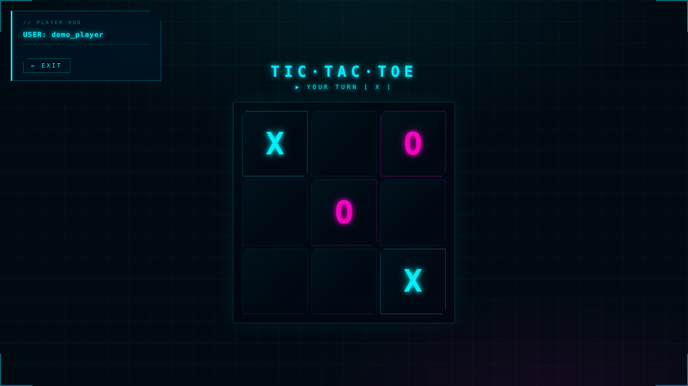
</p>

The computer opponent and the board state both live on the server.

- On load the page calls `/ttt/Start` and `/ttt/player` to learn whether you are `X` or `O`. If you are `O`, the opponent moves first.
- Each click marks the cell, sends the cell index to `/ttt/move`, then asks `/ttt/Checkwin` (sending your username) whether the game ended. The answer is `1` for a win, `2` for a loss, `3` for a draw.
- If the game continues, `/ttt/enemymove` returns the opponent's cell and the page draws it.
- An `isProcessing` flag blocks clicks while the opponent is "computing", so you can't move out of turn.

### 3. Ping Pong

<p align="center">
  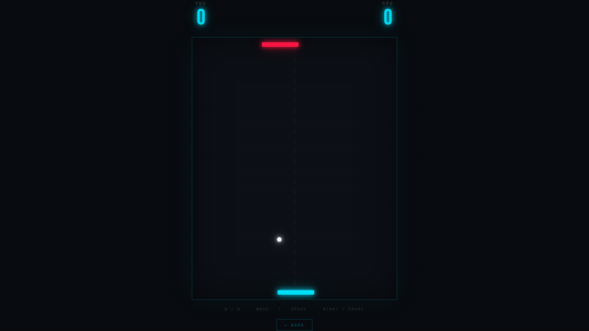
</p>

Everything here runs in the browser; only the final result is sent to the backend (`/pingpong/end`).

- A `requestAnimationFrame` loop moves the paddles and the ball.
- The ball bounces off the side walls. Where it lands on a paddle sets the bounce angle (up to 65°), and every paddle hit speeds it up by 4%.
- The CPU paddle chases the ball with a capped speed, so it can be beaten.
- First to 2 points ends the match. Press `Space` to replay.

### 4. Jump Bird

<p align="center">
  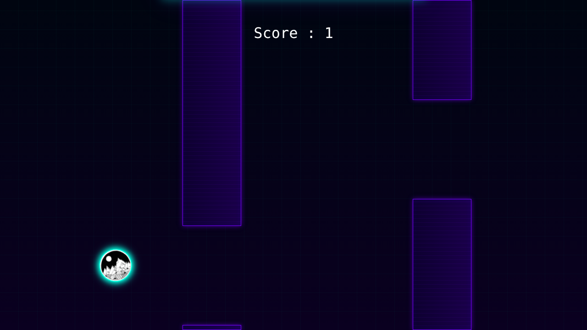
  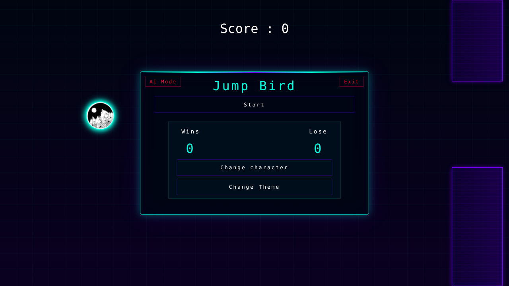
</p>

A Flappy-Bird-style game, also fully client-side (`Games/test/game.js`, result sent to `/bird/end`).

- Gravity grows every frame; `Space` gives a quick upward boost.
- Touching a pillar or leaving the screen is a loss. Passing a pillar adds 1 to the score, and every 10th pillar earns a win.
- **AI Mode** lets the bird play itself, which is also what runs behind the menu. It records no scores.
- **Change character** swaps the bird for one of 8 images in `Games/test/image/`. **Change Theme** recolors the background, the bird's glow and the pillars.

### 5. Deflect

<p align="center">
  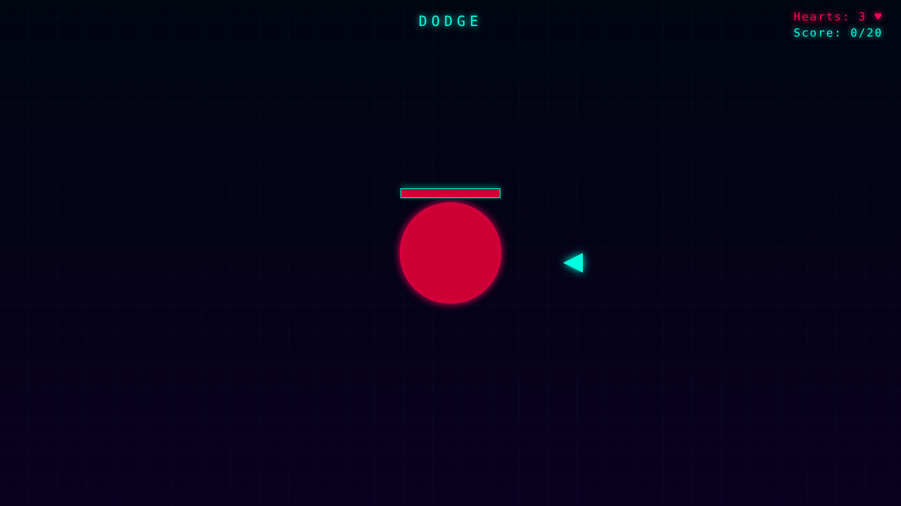
  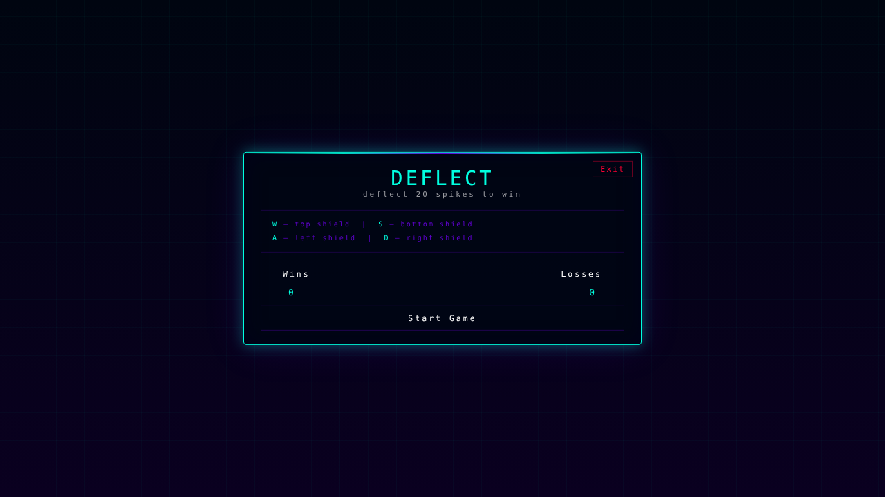
</p>

You are the red circle in the middle of the screen. Spikes fly in from the top, right, bottom or left (`Games/Dodgy/Dodge.js`, result sent to `/Dodge/end`).

- `W`, `A`, `S`, `D` turn your shield to the top, left, bottom or right.
- When a spike reaches you, it is deflected if the shield faces the side it came from. Otherwise you lose a heart.
- The spawn timer is picked once per round, between 0.8 and 1.8 seconds.
- Reach 20 deflections to win. Lose all 3 hearts and the round is lost.

---

## Screens around the games

<table>
  <tr>
    <td width="50%">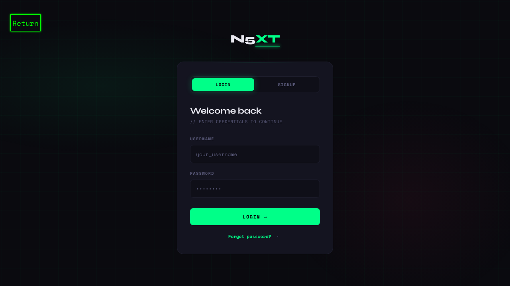</td>
    <td width="50%">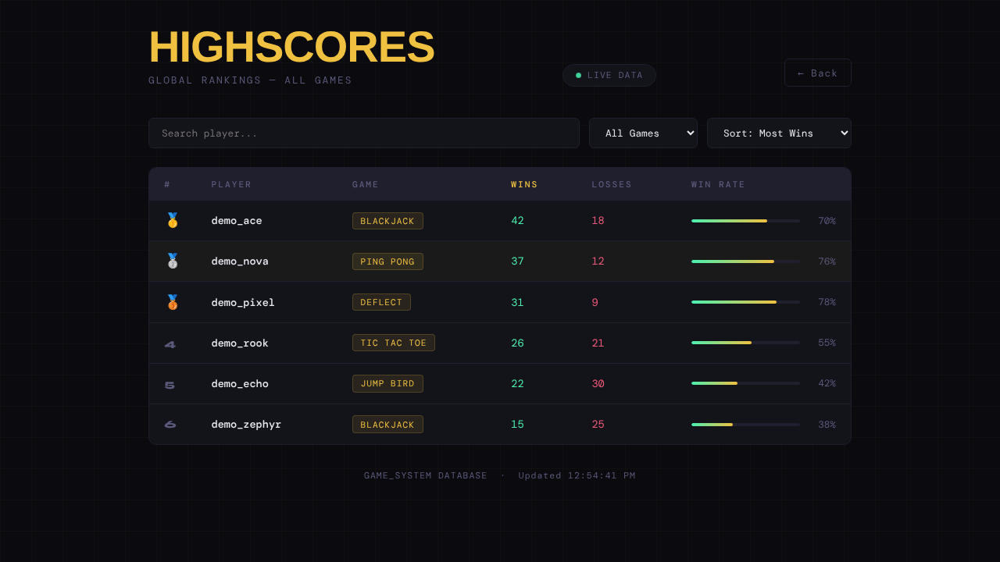</td>
  </tr>
  <tr>
    <td align="center"><b>Account</b><br>Login, signup and password reset, all verified by email code</td>
    <td align="center"><b>High Scores</b><br>Search, filter by game, sort, and win-rate bars</td>
  </tr>
</table>

- **High Scores** (`Main/highscores.js`) downloads rows of `username`, `gameName`, `wins` and `losses`, then filters, sorts and renders the table in the browser. It refreshes every 30 seconds and shows gold, silver and bronze medals for the top three.
- **Settings** has a color wheel. Changing it updates the `--cyan` CSS variable immediately and sends the new color to the backend, which is read back on the next visit.
- **About Us** (top right of the menu) tells the team's story.

> *Screenshots were captured with Playwright against a local copy. The hosted API was stubbed for the capture, so the leaderboard rows and the Blackjack and Tic Tac Toe moves shown are sample data.*

---

## How it works

**The frontend is a restaurant's dining room, the API is the kitchen.** The pages only show things and take orders: they ask the hosted API for accounts, scores and Blackjack cards. That split keeps this repo to plain HTML, CSS and JavaScript with nothing to build.

**The API is the referee and the scoreboard.** Blackjack and Tic Tac Toe ask it for each card and each opponent move, and every game reports a win or a loss with your username. The leaderboard then reads those tallies back, which is why scores persist across devices.

**localStorage is a name badge.** After login the browser pins `login=true` and your username to it. The menu checks the badge before showing the game list, and each game reads the name from it. That's how HTML pages know who you are and which player a score belongs to.

**Email OTP is a two-key lock.** After the usual username and password, the site emails a 6-digit code that you type into a pop-up before login or signup finishes. That second key is meant to prove the email address really belongs to you.

### System flow

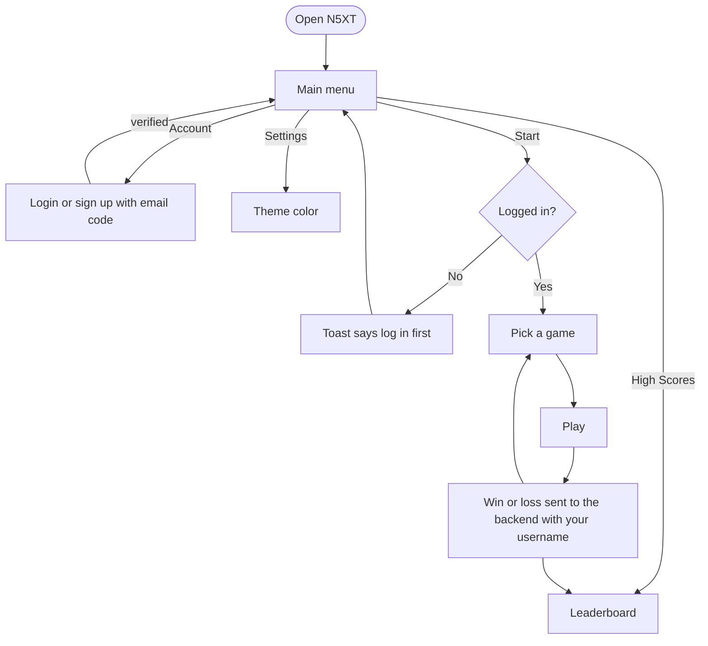

### Sign-in flows (`Login/script.js`)

- **Log in:** look up the email for the username → check the password → send a code → verify it in the pop-up → log in again, store `login` and `username`, go to the menu.
- **Sign up:** make sure the username is free → send a code to the email → verify it → register the account and log in.
- **Forgot password:** enter the email → verify the code → choose a new password (minimum 6 characters, with a strength meter) → log in again.

---

## Project structure

```
N5XT/
├── index.html            Main menu, game picker, settings, About Us
├── Login.html            Login, signup, forgot password, OTP pop-up
├── highscores.html       Global leaderboard
├── Main/
│   ├── code.js           Menu logic: navigation, login gate, toasts, theme color
│   ├── design.css        Main menu styling
│   ├── highscores.js     Fetch, filter, sort and render the leaderboard
│   └── highscores.css
├── Login/
│   ├── script.js         Auth flows and OTP pop-up
│   └── style.css
├── Image/                Menu hero art and game-card images
├── docs/screenshots/     Images used in this README
└── Games/
    ├── MainJs.js         Shared helpers (back to menu, wait)
    ├── Blackjack/        Blackjack.html / .js / .css, BJD.js, Css.js, keyframes.css, Cards/ (68 images)
    ├── TTT/              Tic Tac Toe
    ├── pingpong/         Ping Pong
    ├── Dodgy/            Deflect
    └── test/             Jump Bird (character images in image/)
```

---

## Getting started

N5XT is a static site, so there is nothing to install or build.

1. **Get the code**
   ```bash
   git clone https://github.com/ArpedXD/N5XT
   cd N5XT
   ```
2. **Serve the folder** with any static server, for example:
   ```bash
   python -m http.server 5500
   ```
   or use the VS Code **Live Server** extension.
3. **Open** the address your server prints (for example `http://localhost:5500`).
4. **Create an account** under **Account → Sign up**, enter the code that arrives by email, then press **Start** and pick a game.

You need an internet connection: the pages load Google Fonts and talk to the hosted backend.

**Backend:** the API is not part of this repository. The frontend calls two hosted services, one for accounts and email codes and one for games, scores and the theme color. Their base URLs are written directly into the code:

| What | Where the URL is set |
|---|---|
| Accounts and email codes | `BASE` in `Login/script.js` |
| Leaderboard | `API_BASE` in `Main/highscores.js` |
| Theme color | two `fetch` calls in `Main/code.js` |
| Game results and moves | `fetch` calls in each game's JavaScript file |

If you run your own backend, change those URLs. If requests fail with a CORS error, check which origins the backend allows.

---

## Backend endpoints the frontend uses

**Accounts** (called from `Login/script.js`)

| Method | Path | Purpose |
|---|---|---|
| `GET` | `/base/getEmail?username=` | Find the email for a username (empty means not found) |
| `POST` | `/base/login` | Check `username` and `password` |
| `POST` | `/base/register` | Create an account from `username`, `email`, `password` |
| `POST` | `/base/sendOtp` | Email a 6-digit code to `email` |
| `POST` | `/base/verifyOtp` | Check `email` and `otp` |
| `POST` | `/base/changePassword` | Set a new `password` for `email` |

**Platform and games**

| Method | Path | Purpose |
|---|---|---|
| `GET` / `POST` | `/base/Color` | Read and save the theme color |
| `GET` | `/controller/highscores` | Rows of `username`, `gameName`, `wins`, `losses` |
| `GET` | `/blackjack/start`, `/number`, `/number2`, `/getTotal`, `/getEnemy` | Start a round, deal cards, read totals |
| `POST` | `/blackjack/receive` | Record a Blackjack result |
| `GET` | `/ttt/Start`, `/ttt/player`, `/ttt/enemymove` | Start a game, get your mark, get the opponent's move |
| `POST` | `/ttt/move`, `/ttt/Checkwin` | Send your move, check for a result |
| `POST` | `/pingpong/end`, `/Dodge/end`, `/bird/end` | Record a result |

Result calls send `{ "a": "win" | "lose", "b": "<username>" }`. Tic Tac Toe sends the username as plain text to `/ttt/Checkwin`.

---

## Known limitations

- **The login check lives in the browser.** `login` and `username` sit in `localStorage`, so they gate the interface but don't secure it.
- **Scores are reported by the page.** Ping Pong, Jump Bird and Deflect decide the result in the browser and send it with whatever username is stored, so the leaderboard trusts the client.
- **Draws are not recorded** in Blackjack or Tic Tac Toe.
- **The theme color is sent without a username**, so it behaves like one site-wide setting rather than a per-player one.
- **Backend URLs are hard-coded** in several files; moving them into one config file would make switching servers easier.

---

## About the project

<details>
<summary><b>Documentation summary</b> (problem, objectives, design, background)</summary>

### Problem

Many simple games have no central place where players can reach several games and track their scores. Without one, players can't easily monitor their own performance or compare it with others.

### Objectives

**General:** build N5XT (NEXT 5), a multi-game system that lets players enjoy different games on one platform while their scores are tracked.

**Specific:**

1. Provide multiple mini-games in one system.
2. Let users register or log in before entering a game.
3. Record players' scores automatically.
4. Show player rankings on a leaderboard.
5. Keep the interface simple and user-friendly.

### System description

N5XT is an entertainment platform with several mini-games in one application. Players choose a game, enter their name, and play while their scores are recorded. A leaderboard shows the highest scores so players can compare themselves with others.

### Interface design

The main menu offers four options: **Start**, **Account**, **High Scores** and **Settings**. Minimal buttons and an organized layout reduce confusion, and the visual style keeps the platform engaging.

### Related studies

Research on gamification suggests that leaderboards can raise engagement and motivation, because players are more active when they can see their progress and ranking (Cigdem et al., 2024; Zhang, van Horen & Zeelenberg, 2021). N5XT applies that idea to a small multi-game platform that records names and scores.

### Result

The team reports that the planned main menu, game selection, account system and score tracking, together with all five games, are implemented and working.

</details>

Made by **Group N5XT**, first-year students who wanted to build simple, enjoyable web games in the spirit of Friv-style platforms.
